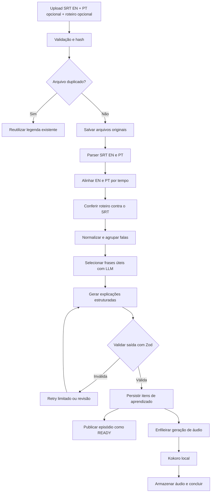

# Plataforma de inglês com IA, séries e gamificação

> Documento de visão e especificação do MVP.
> Nome do produto ainda em aberto. O protótipo usa **Deixa** como nome provisório. Candidatos: **Take**, **Cena**, **Fala**, **Maratona**.
> Protótipo de interface aprovado: `prototipo.html` (mobile-first, dados simulados).

---

## 1. Visão do produto

Aprender inglês a partir de séries e filmes reais, com uma experiência gamificada inspirada no Duolingo, mas com identidade visual e navegação próprias.

O usuário escolhe a série e o episódio que está assistindo, e a plataforma transforma as legendas em uma trilha de aprendizado personalizada para o nível dele.

### Pilares

| Pilar | O que entrega |
| --- | --- |
| **Aprender com séries e filmes** | Catálogo de séries, temporadas, episódios e filmes. O usuário escolhe o episódio e começa a estudar, sem precisar fazer upload de novo. |
| **Trilha personalizada por nível** | Flashcards, tradução, compreensão auditiva, expressões cotidianas, escrita e repetição espaçada, adaptados do iniciante ao avançado. |
| **Gamificação** | Foguinhos (sequência), XP, metas diárias, missões, conquistas, níveis e estatísticas. Recompensa estudo consistente, não só acerto de perguntas fáceis. |
| **Ler o episódio inteiro e marcar** | A legenda completa do episódio em inglês e português, lado a lado. O usuário marca as palavras e falas que não entendeu, e a IA transforma as marcações em cards de revisão. |
| **Conversação com IA** | Simulações de situações reais, correção de frases e, numa segunda fase, chamadas de voz com um tutor. |

### O que diferencia do Duolingo e similares

Apps de idioma ensinam um currículo fixo, igual para todo mundo. Aqui o conteúdo é **o episódio que a pessoa acabou de assistir**, e quem decide o que vale estudar é ela: ao ler a legenda inteira, marca exatamente as palavras e falas que não entendeu. Os cards de revisão nascem dessas dúvidas reais, não de uma lista pronta.

Três decisões sustentam isso:

1. **Legenda em português enviada junto com a em inglês.** As falas já chegam traduzidas por quem fez a legenda. A IA não precisa traduzir; só explica o termo no contexto. Fica mais barato, mais rápido e mais fiel à cena.
2. **Leitura do episódio inteiro com marcador.** Nenhuma fala fica de fora, mesmo as que a IA não selecionou para a trilha.
3. **Roteiro opcional** para cobrir falas que a legenda corta ou resume.

### Regra central

**O catálogo é compartilhado. O aprendizado é individual.**

Cada pessoa tem sua própria conta, progresso, vocabulário, sequência, metas, revisões e nível. Se um usuário conclui o episódio 3, isso não muda nada na conta de outro usuário. Um episódio importado uma vez fica disponível para todos.

---

## 2. Níveis de aprendizado

A plataforma precisa atender desde quem está começando do zero até quem já assiste sem legenda. A referência é o **QECR** (Quadro Europeu Comum de Referência).

| Nível | Nome no app | Perfil típico | Como o conteúdo se adapta |
| --- | --- | --- | --- |
| A1 | Iniciante | Nunca estudou ou sabe poucas palavras | Frases curtas, tradução em PT sempre visível, pronúncia aproximada para brasileiros, áudio mais lento, exercícios de múltipla escolha e montagem de frase com apoio em PT |
| A2 | Básico | Entende frases simples do dia a dia | Mais escuta, menos apoio em PT, início de contrações |
| B1 | Intermediário | Entende muito com legenda | Phrasal verbs, contrações faladas ("gonna", "wanna"), gírias, ditado, tradução PT→EN digitada, falsos cognatos |
| B2 | Intermediário superior | Acompanha conversas rápidas com legenda em inglês | Escuta sem legenda, expressões idiomáticas, variação de sotaque |
| C1 | Avançado | Assiste sem legenda | Subtexto, ironia, registro formal vs. informal, sotaques (ex.: britânico), IPA, escrita diplomática avaliada pela IA |
| C2 | Fluente | Domínio quase nativo | Nuance cultural, humor, referências, velocidade nativa |

### Regras de nível

- O nível inicial vem de um teste rápido no cadastro ou da escolha do usuário.
- O progresso dentro do nível é exibido em percentual até o próximo nível.
- Cada obra do catálogo tem uma faixa de nível (ex.: Friends A1–B1, Ted Lasso B2–C2).
- O catálogo mostra se a obra está "No seu nível", "Desafiador" ou "Tranquilo" em relação ao usuário.
- O mesmo episódio gera exercícios diferentes conforme o nível de quem estuda.

---

## 3. Experiência e interface

### Princípios

- **Mobile-first.** O uso principal é no celular. No desktop, a mesma coluna centralizada ou barra lateral.
- Mesmos princípios de usabilidade do Duolingo (progresso visual, sessões curtas, feedback imediato, metas, recompensas), **sem copiar** identidade visual, personagens, ilustrações ou telas.
- Identidade própria baseada no universo de legendas e cinema: texto de legenda amarelo sobre fundo escuro, timecodes de SRT, trilha marcada pelo tempo do episódio.
- Ambiente de estudo limpo: uma tarefa por vez, sem distrações.
- Tema claro e escuro.

### Navegação (barra inferior com 5 áreas)

| Área | Conteúdo |
| --- | --- |
| **Início** | Botão "Continuar estudando", botão "Ler episódio e marcar", meta do dia, trilha do episódio atual, revisões pendentes, missões do dia |
| **Explorar** | Busca, filtros (Todos, No meu nível, Séries, Filmes), títulos em andamento, catálogo de pôsteres, detalhe da obra com temporadas e episódios (cada episódio com "Estudar" e "Ler e marcar"), envio de legendas EN/PT e roteiro |
| **Revisar** | Flashcards vencidos (repetição espaçada), incluindo os cards criados a partir das marcações; erros recorrentes |
| **Conversar** | Cenários com o tutor de IA ordenados pelo nível, chat com correções, chamada de voz (fase 2) |
| **Progresso** | Nível QECR, sequência, XP total, expressões aprendidas, precisão, XP da semana, dias estudados, compreensão por habilidade, conquistas |

Topo fixo com avatar (abre perfil e configurações), nível atual, foguinho e XP do dia.

### Trilha do episódio

- Cada parada da trilha é uma **cena** do episódio, identificada pelo timecode da legenda (ex.: `00:04:40`).
- Estados: concluída, atual (destacada), bloqueada.
- A última parada é o desafio final do episódio.

### Tipos de exercício

| Tipo | Descrição | Níveis principais |
| --- | --- | --- |
| Apresentação | Nova expressão com a fala original, timecode, áudio normal e lento, tradução, pronúncia e contexto | Todos |
| Múltipla escolha | Significado de uma fala, com a cena como contexto | Todos |
| Escuta | Ouvir e escolher o que foi dito (legenda oculta) | A1–B2 |
| Montar a frase | Tocar nas palavras na ordem certa, a partir do PT ou do áudio | A1–B1 |
| Completar lacuna | Escolher a palavra que falta (phrasal verbs, adjetivos, expressões) | Todos |
| Tradução digitada | Escrever em inglês a partir do PT, aceitando variações válidas | B1+ |
| Ditado | Ouvir e escrever exatamente | B1+ |
| Interpretação de subtexto | O que a fala sugere (ironia, discordância, educação) | B2+ |
| Registro | Qual opção soa mais natural em determinado contexto | B2+ |
| Escrita livre | Reescrever uma frase com outro tom; avaliação e sugestão pela IA | C1+ |

### Feedback

- Resposta certa: barra verde, elogio curto, explicação.
- Resposta errada: barra vermelha, resposta correta, explicação do porquê.
- Itens errados vão para a fila de revisão.
- Tela final da lição: XP, precisão, tempo, itens adicionados à revisão.

### Perfis de exemplo (usados no protótipo)

| Perfil | Nível | Série atual | Foco |
| --- | --- | --- | --- |
| Ana | A1 | Friends | Começando do zero, com apoio em português |
| Matheus | B1 | How I Met Your Mother | Entende com legenda, quer largar a legenda |
| Lucas | C1 | Ted Lasso | Assiste sem legenda, foca em sotaque, ironia e registro |

---

## 4. Arquitetura técnica do MVP

Monólito modular em TypeScript, com um processo separado para tarefas pesadas. Mantém custo operacional baixo sem criar microsserviços prematuros.

A aplicação continua em Next.js, sem separar frontend e backend agora. A separação acontece nas camadas de **domínio**, **aplicação** e **infraestrutura**, para permitir extrair serviços depois sem reescrever regras de negócio.

```
┌──────────────────────────────────────────────────────────┐
│ Aplicação Next.js                                        │
│ Web responsiva · celular e desktop · catálogo · estudo   │
├──────────────────────────────────────────────────────────┤
│ Application layer                                        │
│ Casos de uso · autenticação · autorização · validação    │
├───────────────┬───────────────────────┬──────────────────┤
│ Mastra        │ Worker                │                  │
│ Workflows IA, │ Importação SRT,       │                  │
│ exercícios,   │ processamento, áudio, │                  │
│ tutor         │ retentativas          │                  │
├───────────────┴──────┬────────────────┴──────────────────┤
│ PostgreSQL           │ Arquivos (SRT, áudio) │ Kokoro    │
│ dados e progresso    │                       │ TTS local │
└──────────────────────┴───────────────────────┴───────────┘
```

### Tecnologias

| Componente | Escolha inicial |
| --- | --- |
| Frontend e API | Next.js + TypeScript |
| UI | Tailwind CSS + shadcn/ui, com design próprio |
| Validação | Zod |
| Banco | PostgreSQL + Drizzle ORM |
| Orquestração de IA | Mastra |
| Provedor de LLM | Google Gemini, com a chave do usuário |
| Geração de voz | Kokoro, em processo ou serviço local separado |
| Fila | Redis + BullMQ, quando o processamento assíncrono justificar |
| Arquivos | Diretório persistente no desenvolvimento; storage compatível com S3 em produção |
| Metadados do catálogo | API do TMDB |
| Testes | Vitest + testes de integração + Playwright |

**Fora do escopo inicial:** Kubernetes, microsserviços, BigQuery, embeddings e RAG. PostgreSQL é suficiente para catálogo, legendas, cartões e progresso; as consultas são estruturadas e resolvidas com SQL.

---

## 5. Catálogo compartilhado

O conteúdo é cadastrado uma vez e reutilizado por todos os usuários. Qualquer usuário pode importar um episódio pelo computador ou celular.

### Fluxo de cadastro

1. Buscar a série ou o filme por nome na integração de metadados (TMDB).
2. Selecionar a obra, a temporada e o episódio, ou cadastrar manualmente se não encontrar.
3. Enviar os arquivos do episódio:
   - legenda em inglês (`.srt`, obrigatória);
   - legenda em português (`.srt`, opcional, recomendada);
   - roteiro ou transcrição (`.txt` ou `.pdf`, opcional).
   Sem roteiro, o usuário pode pedir para a IA buscar uma transcrição (ver seção 6).
4. O sistema valida os arquivos, calcula os hashes, verifica duplicidade e cria um job de processamento.
5. Se a legenda já existir, reutiliza a existente e não reprocessa.
6. Após o processamento, o episódio fica `READY` e aparece no catálogo para todos.
7. Qualquer usuário seleciona o episódio e estuda, sem novo upload.

A integração com o TMDB serve para identificar a obra (títulos, sinopses, pôsteres, temporadas, IDs externos), **não** para baixar legendas. A chave do TMDB é configurada pelo administrador e é diferente da chave do Gemini de cada usuário.

### Estados de um episódio no catálogo

| Estado | Significado na interface |
| --- | --- |
| `UPLOADED` | Arquivo recebido, aguardando processamento |
| `PROCESSING` | Em processamento |
| `READY` | Pronto para estudar (áudios podem ainda estar sendo gerados) |
| `FAILED` | Falhou; pode ser reprocessado |
| `NEEDS_REVIEW` | Saída da IA precisa de revisão manual |
| sem legenda | Episódio cadastrado, sem SRT enviado |

### Organização dos arquivos (desenvolvimento)

Diretório persistente fora da pasta de código versionada:

```
data/
├── catalog/
│   ├── series/
│   │   └── {seriesId}/
│   │       └── seasons/
│   │           └── {seasonNumber}/
│   │               └── episodes/
│   │                   └── {episodeId}/
│   │                       ├── original.en.srt
│   │                       ├── original.pt-BR.srt
│   │                       ├── script.txt
│   │                       ├── alignment.json
│   │                       └── normalized.json
│   └── movies/
├── audio/
│   └── {voiceId}/{textHash}.wav
└── temp/
```

O PostgreSQL guarda metadados, caminhos relativos, hashes e estados. Os arquivos ficam no disco, nunca como binários grandes no banco.

**Produção:** não usar disco efêmero do deploy do Next.js. Usar volume persistente ou armazenamento de objetos. Antes de abrir o catálogo para outras pessoas, verificar os direitos de redistribuição das legendas e roteiros; o catálogo compartilhado não deve tornar públicos arquivos sem autorização. Isso vale ainda mais para a leitura do episódio inteiro, que exibe a legenda completa.

---

## 6. Legenda em português e roteiro

### Legenda em português (PT-BR)

Enviar a legenda traduzida junto com a original faz a tradução de cada fala vir pronta, feita por quem legendou. A LLM deixa de traduzir e só explica termos no contexto.

**Alinhamento EN ↔ PT**

Legendas de idiomas diferentes raramente têm a mesma quantidade de blocos nem os mesmos tempos exatos. O alinhamento é feito por sobreposição de tempo:

1. Para cada bloco EN, encontrar os blocos PT cujo intervalo `[start_ms, end_ms]` se sobrepõe a ele.
2. Calcular a pontuação de sobreposição (tempo em comum ÷ duração da fala EN).
3. Aceitar pares 1:1 acima de um limite (ex.: 0,6). Tratar 1:N e N:1 quando a legenda PT juntou ou dividiu falas.
4. Tolerar deslocamento fixo: se a maioria dos pares tem o mesmo atraso (ex.: legenda PT 800 ms adiantada), aplicar a correção antes de alinhar.
5. Falas sem par ou com pontuação baixa ficam marcadas como `UNALIGNED`; nesses casos, a tradução cai para a LLM.
6. Mostrar a taxa de alinhamento no processamento (ex.: "398 pares · 97%").

O alinhamento é determinístico: não usa LLM e é barato de reprocessar.

**Quando a LLM ainda é usada**

| Situação | Origem da tradução |
| --- | --- |
| Tradução de uma fala inteira, com par alinhado | Legenda PT (sem LLM) |
| Fala sem par ou alinhamento ruim | LLM, marcada como "tradução por IA" |
| Episódio sem legenda PT | LLM, marcada como "tradução por IA" |
| Significado de uma palavra ou expressão no contexto | LLM (a legenda PT entra no prompt como contexto) |

A interface sempre mostra a origem da tradução com uma etiqueta (**PT** ou **IA**).

### Roteiro ou transcrição

Legendas cortam e resumem falas para caber na tela. Um roteiro ou transcrição completa ajuda a recuperar o que foi dito de fato.

- **Envio pelo usuário** (`.txt` ou `.pdf`): o texto é conferido contra o SRT em inglês, por similaridade de texto e ordem, e usado para completar falas cortadas.
- **Busca com IA**: opção para quando não há roteiro. A IA procura uma transcrição e preenche falas que faltam.

Cuidados com a busca por IA:

- A LLM pode inventar falas. Todo trecho que não bate com o SRT fica marcado como **"não verificado"** e nunca vira item de aprendizado global sem revisão.
- Transcrições de séries costumam ter direitos autorais. Usar só fontes com permissão, guardar a origem (`source_url`) e não exibir o roteiro completo publicamente.
- Por custo e risco, a busca é opcional, por episódio, e usa a chave administrativa.

---

## 7. Ler o episódio inteiro e marcar

Em episódios aleatórios, sempre sobra alguma fala que a pessoa não entendeu e que não estava na trilha. Este modo resolve isso.

### Experiência

1. O usuário abre **"Ler episódio e marcar"** na Início ou no detalhe do episódio.
2. A legenda inteira aparece em ordem, dividida por cenas, com o timecode de cada fala e um botão para ouvir. O áudio de cada fala é gerado sob demanda no primeiro toque e fica em cache (seção 9, etapa 5).
3. Três modos de exibição, com padrão pelo nível:
   - **EN + PT** (padrão A1–A2): português sempre abaixo do inglês.
   - **PT ao tocar** (padrão B1–B2): o português aparece só quando o usuário pede.
   - **Só inglês** (padrão C1+).
4. **Marcador:**
   - tocar numa palavra marca ou desmarca;
   - palavras vizinhas marcadas na mesma fala viram uma expressão (ex.: "picked" + "up" + "the" + "tab" → "picked up the tab");
   - o botão de marcador ao lado da fala salva a fala inteira.
5. Busca dentro do episódio: "procurar uma fala que você ouviu", em inglês ou português.
6. Contador de marcações no rodapé e botão **"Gerar cards"**.
7. Falas que outros alunos marcaram mostram uma etiqueta anônima ("marcada por 3 alunos").

### Geração dos cards

1. Agrupar marcações vizinhas em expressões.
2. Pegar a tradução da fala na legenda PT alinhada (sem LLM).
3. Uma única chamada em lote ao Gemini (chave do usuário) para explicar cada termo no contexto da cena: significado, tipo (palavra, expressão, phrasal verb, gíria), nível, pronúncia e um exemplo. Saída validada por Zod.
4. Se o termo já existir como `learning_item` daquele episódio, reutilizar em vez de gerar de novo.
5. Mostrar a lista de cards para revisão antes de salvar; o usuário pode remover qualquer um.
6. Escolher o alcance:
   - **Só para mim**: cards privados, marcações não compartilhadas.
   - **Para o catálogo**: os cards também viram sugestões para quem estudar o episódio, e as marcações entram numa contagem anônima.
7. Salvar: os cards entram na fila de repetição espaçada do usuário, com a fala original como contexto. Rende XP.

### Uso global das marcações

- As marcações de todos os alunos formam um mapa de dificuldade do episódio: as falas mais marcadas indicam onde as pessoas travam.
- Esse mapa alimenta a seleção pedagógica (seção 9): termos muito marcados ganham prioridade na trilha de quem estudar depois.
- A contagem é anônima. Com poucos usuários, exibir só a partir de um número mínimo de marcações para não identificar ninguém.
- Um card global novo passa por validação (Zod e, se preciso, revisão) antes de aparecer para outras pessoas.

---

## 8. Modelo de dados

Separar catálogo global, biblioteca individual, progresso educacional e configuração de IA, para que reprocessar um episódio não apague o progresso de ninguém.

### Identidade e acesso

| Tabela | Campos |
| --- | --- |
| `users` | id, name, email, password_hash, created_at |
| `user_ai_credentials` | user_id, provider, encrypted_api_key, key_version, updated_at |
| `user_preferences` | user_id, level, native_language, daily_goal, preferred_accent, audio_speed, timezone |

### Catálogo compartilhado

| Tabela | Campos |
| --- | --- |
| `media_items` | id, type, title, original_title, metadata_provider, external_id, poster_path, level_min, level_max |
| `seasons` | id, media_item_id, season_number, title |
| `episodes` | id, season_id, episode_number, title, duration_seconds |
| `subtitle_files` | id, episode_id, language (`en`, `pt-BR`), format, storage_path, sha256, status, processing_version, uploaded_by |
| `subtitle_cues` | id, subtitle_file_id, sequence, start_ms, end_ms, text |
| `cue_alignments` | id, episode_id, en_cue_id, pt_cue_ids, overlap_score, offset_ms, status (`ALIGNED`, `UNALIGNED`, `MANUAL`) |
| `episode_scripts` | id, episode_id, source (`upload`, `ai_search`), source_url, storage_path, sha256, status |
| `script_lines` | id, script_id, sequence, text, matched_cue_id, verified |

### Aprendizado

| Tabela | Campos |
| --- | --- |
| `learning_items` | id, subtitle_file_id, cue_id, start_ms, end_ms, source_text, normalized_text, difficulty, item_type, origin (`curated`, `user_highlight`), visibility (`global`, `private`), owner_user_id, status |
| `learning_item_explanations` | learning_item_id, locale, translation, translation_source (`subtitle_pt`, `llm`), pronunciation_guide, ipa, grammar_note, context_note |
| `user_highlights` | id, user_id, episode_id, cue_id, start_token, end_token, kind (`word`, `phrase`, `line`), share_scope (`private`, `catalog`), created_at |
| `highlight_stats` | episode_id, cue_id, start_token, end_token, user_count (agregado e anônimo) |
| `highlight_card_batches` | id, user_id, episode_id, highlights_count, cards_created, llm_calls, created_at |
| `audio_assets` | id, text_hash, voice_id, format, storage_path, status |
| `user_cards` | id, user_id, learning_item_id, due_at, interval_days, repetitions, lapses, stability, difficulty |
| `review_logs` | id, user_card_id, rating, response_time_ms, reviewed_at |
| `episode_progress` | user_id, episode_id, status, progress_percent, last_position_ms, completed_at |

### Gamificação e conversação

| Tabela | Campos |
| --- | --- |
| `xp_events` | id, user_id, source, source_id, amount, created_at |
| `user_daily_activity` | user_id, activity_date, xp_earned, study_seconds, completed_goal |
| `user_streaks` | user_id, current_streak, longest_streak, last_activity_date, freezes_available |
| `achievements` / `user_achievements` | Definição das conquistas e data de desbloqueio por usuário |
| `daily_missions` / `user_missions` | Missões do dia e progresso de cada usuário |
| `conversation_sessions` / `conversation_turns` | Sessões com IA, transcrições, correções, duração e frases praticadas |

### Relações fundamentais

- Uma obra tem temporadas e/ou episódios; filmes podem ter legendas ligadas diretamente à obra.
- Um episódio pode ter várias versões de legenda, idiomas ou revisões.
- Uma legenda gera várias frases de aprendizado.
- Uma frase pode estar nos cartões de muitos usuários.
- Cada usuário tem suas próprias revisões, avaliações, metas e progresso.
- Um cartão referencia o item compartilhado; não duplica tradução nem áudio.
- Restrição única para obra + episódio + idioma + versão + hash, com estratégia explícita para versões diferentes de legenda.
- Um episódio pode ter uma legenda EN e uma PT; o alinhamento liga os blocos das duas.
- Marcações referenciam o bloco da legenda EN e a posição das palavras (tokens), para sobreviver a reprocessamentos que não mudam o texto.
- Um card criado a partir de marcação aponta para um `learning_item` com `origin = user_highlight`; se o alcance for privado, só o dono o vê.

### Por que separar `subtitle_cues` de `learning_items`

Uma legenda não equivale a uma frase útil para aprender. Uma fala pode estar dividida em três timestamps, e uma frase pode precisar juntar duas legendas consecutivas. O original é preservado para sincronização e auditoria; o texto didático pode ser corrigido, pontuado e enriquecido sem alterar o arquivo.

---

## 9. Pipeline de processamento com Mastra

Workflow determinístico com etapas explícitas e chamadas de IA com saída validada por Zod. Nada de agente autônomo decidindo tudo livremente.



### Etapas

**1. Importação**
- Validar extensão, tamanho máximo e codificação.
- Ler o SRT com parser próprio.
- Calcular SHA-256 e detectar duplicidade.
- Salvar o original antes de processar.
- Criar registro de job com estado e tentativas.

**1b. Alinhamento e roteiro**
- Ler a legenda PT, quando existir, e alinhar com a EN por tempo (seção 6).
- Conferir o roteiro contra o SRT EN e marcar o que foi verificado.
- Gravar `cue_alignments` e `script_lines`. Nenhuma etapa aqui usa LLM, exceto a busca opcional de transcrição.

**2. Normalização**
- Preservar timestamps e ordem.
- Remover marcadores de formatação sem destruir pontuação ou contrações.
- Agrupar linhas que formam a mesma frase.
- Identificar frases incompletas, nomes próprios e falas de baixa utilidade.
- Manter referência ao trecho original.

**3. Seleção pedagógica com LLM**

Enviar lotes de frases ao Gemini para selecionar o que é mais útil por nível:
- expressões coloquiais;
- phrasal verbs e contrações;
- frases que ajudam a entender conversas;
- estruturas gramaticais recorrentes;
- expressões que a tradução literal não explica.

Não gerar um cartão por fala. Limitar a quantidade por episódio e priorizar expressões novas, frequentes, reutilizáveis ou muito marcadas pelos alunos (`highlight_stats`). Classificar cada item por nível (A1–C2) para alimentar trilhas diferentes.

Com legenda PT alinhada, o campo `translation` vem da legenda e não é pedido à LLM. A tradução PT entra no prompt só como contexto para a explicação.

**4. Enriquecimento**

Saída estruturada por item:

```json
{
  "sourceText": "What are you up to?",
  "translation": "O que você está fazendo?",
  "meaningInContext": "Pergunta informal sobre o que alguém está fazendo ou planejando.",
  "pronunciationGuide": "uó-dâr iú âp tchu",
  "ipa": "/wɒt ɑː juː ʌp tuː/",
  "difficulty": "A2",
  "itemType": "expression",
  "examples": [
    {
      "english": "What are you up to tonight?",
      "portuguese": "O que você vai fazer hoje à noite?"
    }
  ]
}
```

A pronúncia aproximada é apoio, não transcrição fonética perfeita. O IPA é um campo separado, validado à parte e mostrado principalmente para níveis avançados.

**5. Áudio**

O processamento gera áudio **só para os itens da trilha** (`learning_items` selecionados). As demais falas do episódio, usadas na leitura com marcador, têm áudio **sob demanda**:

- Na primeira vez que qualquer usuário toca em "ouvir" numa fala, o backend gera o áudio com o Kokoro e responde quando estiver pronto (a interface mostra "gerando…").
- O arquivo fica em cache pelo hash e serve para todos os usuários dali em diante.
- Falas que ninguém ouve nunca geram custo.
- Para evitar fila, limitar gerações simultâneas por usuário e pré-gerar opcionalmente as próximas 2–3 falas a partir da que foi tocada.

Regras comuns aos dois casos:
- Hash do texto normalizado + voz + idioma + versão do modelo.
- Verificar se o áudio já existe.
- Gerar só o que falta.
- Persistir o arquivo e marcar o job como concluído.
- Permitir regenerar se o arquivo estiver corrompido ou o modelo mudar.

**6. Publicação**

O episódio fica disponível antes de todos os áudios estarem prontos, desde que a interface mostre o estado (ex.: "Pronto · áudio 31/39"). A geração de voz não bloqueia o catálogo.

### Idempotência e falhas

- Toda etapa pode ser repetida sem duplicar frases ou áudios.
- Estados: `UPLOADED`, `PROCESSING`, `READY`, `FAILED`, `NEEDS_REVIEW`, com logs, tentativas e motivo da falha.
- O worker começa como processo Node.js separado, na mesma base de código e banco. Uma tabela de jobs com bloqueio transacional basta no início; Redis + BullMQ entram quando houver necessidade real de fila persistente, concorrência e retentativas.

---

## 10. Chave de API do Google por usuário

Cada pessoa informa sua própria chave do Google AI (Gemini) nas configurações da conta, com tela para cadastrar, testar, atualizar e remover.

### Fluxo

1. O usuário cria a conta.
2. Informa a chave do Google AI (pode ser depois; o app funciona sem ela para revisões).
3. O backend valida a chave com uma requisição de teste.
4. A chave é salva criptografada.
5. Ao iniciar uma atividade com IA, o backend recupera a chave e cria o cliente Gemini daquele usuário.
6. O frontend nunca recebe a chave de volta; mostra só uma versão mascarada (ex.: `AIza••••••••a91F`).

### Segurança obrigatória

- Criptografia autenticada (AES-256-GCM), com a chave mestra em variável de ambiente ou secret manager.
- Nunca guardar a chave em texto puro, logs, URLs ou respostas de API.
- Nunca enviar a chave ao navegador nem salvar em `localStorage`.
- Nunca compartilhar chave entre usuários.
- Rate limit e limite de tamanho por usuário.
- Permitir revogação e exclusão.
- Avisar que o uso pode gerar cobrança na conta Google do próprio usuário.

### Duas categorias de uso de IA

| Uso | Chave |
| --- | --- |
| Processamento global do catálogo (conteúdo compartilhado) | Chave administrativa |
| Busca de transcrição com IA (opcional, por episódio) | Chave administrativa |
| Tutor, exercícios personalizados, avaliação de escrita, conversação | Chave individual de quem estuda |
| Cards gerados a partir das marcações do usuário | Chave individual de quem estuda (1 chamada em lote por geração) |

Uma temporada processada uma vez não é paga de novo por outros usuários. Revisões e flashcards já criados continuam funcionando se o usuário remover a chave.

---

## 11. Gamificação

Módulo de domínio próprio, não elementos visuais espalhados pela interface.

### Elementos

| Elemento | Regra |
| --- | --- |
| **Foguinho (sequência)** | Conta dias seguidos com a meta diária cumprida |
| **XP** | Ganho em lições, revisões, conversas e missões |
| **Meta diária** | Configurável: Leve (50 XP), Regular (100), Firme (150), Intenso (250) |
| **Missões do dia** | Ex.: revisar 10 cartões, concluir 1 lição de escuta, conversar 5 min com o tutor (+20 XP cada) |
| **Conquistas** | Marcos de consistência, vocabulário e compreensão (ex.: Primeira cena, Semana cheia, Phrasal fan, Maratona, Sem legenda, Bom de papo, Ouvido global) |
| **Nível** | Progresso no QECR, exibido como escada A1–C2 com percentual até o próximo nível |
| **Estatísticas** | XP da semana, mapa de dias estudados, expressões aprendidas, precisão, compreensão por habilidade (escuta, vocabulário, gramática, conversação) |

### Atividades que rendem XP

- Concluir lição: base + bônus por acerto + bônus por lição perfeita.
- Revisar flashcards: por revisão concluída.
- Ler o episódio e gerar cards a partir das marcações.
- Compreensão auditiva: ouvir, identificar e entender frases.
- Conversar com o tutor: sessão significativa concluída.
- Missões e conquistas: bônus.

### Regras

- O dia só conta como ativo quando há estudo significativo, não só abrir o app.
- A sequência usa o fuso horário da conta.
- Repetir a mesma lição rende XP reduzido (no protótipo, metade). Não pode haver XP ilimitado.
- XP registrado como eventos (`xp_events`), para auditoria e correção de duplicidades.
- Sequências e metas independentes por usuário.
- Proteção de sequência pode vir depois, sem cobrar para preservar o progresso.
- Sem ranking global ou competição na primeira versão.

---

## 12. Repetição espaçada

- Cartões vêm das frases estudadas, dos erros nas lições, das marcações feitas na leitura do episódio e das correções do tutor.
- Cada cartão mostra a origem (ex.: "How I Met Your Mother · T1 · E3 · suas marcações") e a fala original como contexto.
- Avaliação em 4 botões: **De novo**, **Difícil**, **Bom**, **Fácil**, cada um mostrando o próximo intervalo.
- Algoritmo baseado em estabilidade e dificuldade (FSRS ou SM-2 como ponto de partida), com histórico em `review_logs`.
- Seção de **erros recorrentes** (ex.: "hang out" × "hang up", falsos cognatos).
- Revisões funcionam sem chave de IA.

---

## 13. Conversação com IA

### Fase 1: tutor por texto e áudio

- O usuário escolhe um cenário. Os cenários são ordenados pelo nível do usuário e marcados como **Recomendado**, **Desafio** ou **Revisão**.
- Exemplos: Pedir no café (A1), Check-in no hotel (A2), Combinar um happy hour (B1), Negociar prazo com cliente (B2), Discordar com educação (C1).
- A IA conversa em inglês, recebe respostas digitadas e mostra correções inline (ex.: ~~I want~~ → **I'd like**, com explicação).
- Sugestões de resposta para níveis iniciais.
- Respostas do tutor podem ser ouvidas (Kokoro), no sotaque escolhido pelo usuário.
- Ao final: resumo com XP, turnos e frases corrigidas que viram cartões de revisão.

### Fase 2: chamada de voz

- Fala pelo microfone, respostas faladas, contexto mantido, transcrição e identificação de oportunidades de aprendizado.
- Kokoro resolve a fala gerada, mas é preciso adicionar speech-to-text (ex.: modelo local) e orquestração da conversa.
- Baixa latência exige streaming de áudio, detecção de fim de fala e cancelamento de respostas.
- Avaliação de pronúncia.
- Não entra no primeiro sprint.

O Mastra pode orquestrar a sessão, mas estado conversacional e limites de custo ficam no backend. Cada sessão pertence a um usuário, tem limite de duração e registra itens que podem virar flashcards.

---

## 14. Organização do código

```
src/
├── app/
│   ├── (auth)/
│   ├── (learning)/
│   ├── catalog/
│   ├── study/
│   ├── read/            # leitura do episódio inteiro + marcador
│   ├── review/
│   ├── tutor/
│   ├── progress/
│   ├── settings/
│   └── api/
├── modules/
│   ├── identity/
│   ├── catalog/
│   ├── subtitles/
│   ├── alignment/       # EN ↔ PT por tempo
│   ├── scripts/         # roteiros e transcrições
│   ├── highlights/      # marcações e estatísticas anônimas
│   ├── learning/
│   ├── levels/
│   ├── flashcards/
│   ├── spaced-repetition/
│   ├── gamification/
│   ├── ai-credentials/
│   └── conversations/
├── infrastructure/
│   ├── database/
│   ├── storage/
│   ├── queue/
│   ├── google-ai/
│   ├── tmdb/
│   └── kokoro/
├── workflows/
│   ├── subtitle-import/
│   ├── learning-item-generation/
│   ├── highlight-cards/
│   └── conversation/
└── shared/
    ├── errors/
    ├── validation/
    └── types/
```

Regras:

- Dentro de cada módulo, separar `domain`, `application` e `infrastructure` quando fizer sentido.
- Componentes React não importam repositórios, clientes Gemini ou Kokoro diretamente.
- Workflows do Mastra chamam casos de uso; não escondem regras de negócio. Assim o domínio fica testável e o framework de IA pode ser trocado.

---

## 15. Plano de implementação

| Fase | Escopo |
| --- | --- |
| **01 · Fundação e catálogo** | Autenticação, cadastro, PostgreSQL, integração TMDB, upload de legendas EN e PT pelo celular e desktop, alinhamento EN ↔ PT, armazenamento persistente, deduplicação de SRT, telas de Explorar e detalhe da obra |
| **02 · Leitura e marcador** | Leitura do episódio inteiro com modos EN+PT / PT ao tocar / só EN, marcador de palavras e falas, busca no episódio, geração de cards a partir das marcações (só para mim / para o catálogo), chave Gemini por usuário |
| **03 · Motor de aprendizado** | Workflow Mastra, explicações, classificação por nível, cartões, áudio Kokoro, trilha do episódio e sessão de estudo com os tipos de exercício, roteiro opcional |
| **04 · Retenção e gamificação** | Repetição espaçada, erros recorrentes, XP por eventos, metas diárias, foguinhos, missões, conquistas, tela de Progresso, mapa anônimo de marcações |
| **05 · Tutor de IA** | Conversa por texto, áudio das respostas, cenários por nível, correção contextual, cartões gerados a partir das conversas |
| **06 · Voz e publicação** | Speech-to-text, streaming, avaliação de pronúncia, isolamento entre usuários, limites de uso, privacidade, direitos de legendas e roteiros, storage compartilhado |

A leitura com marcador vem antes do motor de aprendizado completo porque é o diferencial mais claro e precisa de pouca IA: com legenda PT alinhada, já funciona com uma única chamada em lote por geração de cards.

### Critérios de aceite do MVP

- Um usuário cadastra uma série e importa um SRT pelo celular ou computador.
- Ao enviar também a legenda PT, as falas ficam alinhadas por tempo e a tradução das falas não usa LLM.
- O usuário lê o episódio inteiro, marca palavras e falas, e gera cards que entram na revisão dele.
- Cards "só para mim" nunca aparecem para outro usuário; cards "para o catálogo" aparecem como sugestão sem identificar quem marcou.
- Trechos vindos de busca de transcrição por IA aparecem como "não verificado".
- Um segundo usuário cria conta, escolhe o mesmo episódio e estuda sem novo upload.
- O mesmo episódio gera exercícios diferentes para um usuário A1 e um usuário B1.
- A IA gera frases estruturadas com tradução, contexto, nível e orientação de pronúncia.
- O áudio é gerado localmente e reutilizado quando já existe.
- Os flashcards têm histórico e revisões agendadas.
- Sequência diária e XP são calculados corretamente por usuário, no fuso dele.
- Repetir uma lição não gera XP ilimitado.
- Chaves de IA ficam isoladas e protegidas.
- Uma falha no processamento é recuperável sem duplicar dados.
- O sistema funciona sem todos os áudios prontos.
- Dados de um usuário nunca aparecem na conta de outro.

---

## 16. Recomendação de começo

Começar pelo **catálogo compartilhado com legendas EN + PT alinhadas**, pela **leitura do episódio com marcador** e pelo **ambiente de estudo**. Esses três validam o diferencial do produto. Gamificação básica entra junto com os flashcards. Chamadas de voz, ranking e recursos sociais ficam para depois.

O objetivo é usar o sistema em casa desde cedo, testar o método na prática e evoluir para uma plataforma pública sem complexidade desnecessária antes de validar o aprendizado.
