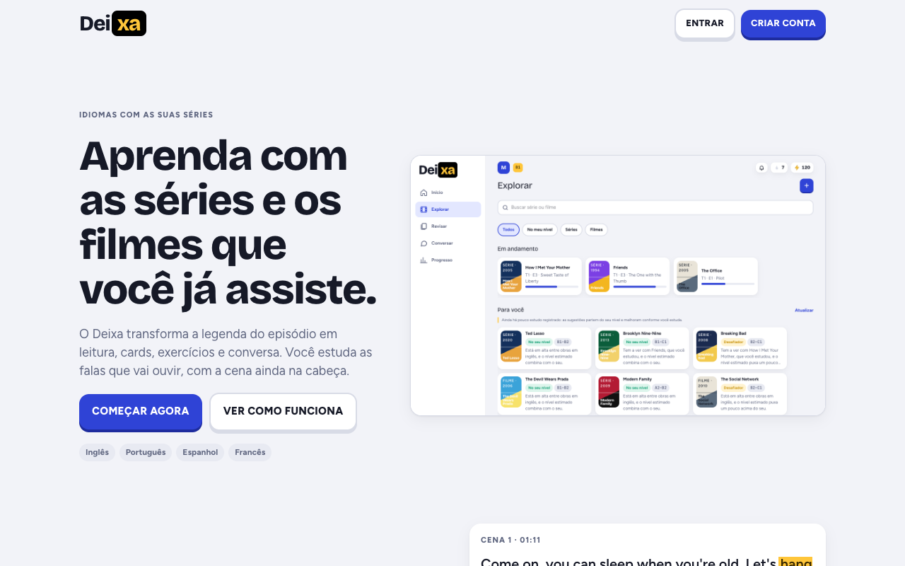

<div align="center">


# Deixa

**Aprenda um idioma com as séries e os filmes que você já assiste.**

Leia o episódio inteiro, marque o que não entendeu, transforme as marcações em revisão e converse com um tutor,
por texto ou por voz.

[](https://github.com/matheus-caldeira/deixa/actions/workflows/ci.yml)
[](https://github.com/matheus-caldeira/deixa/releases)
[](LICENSE.md)
[](#dois-jeitos-de-usar)


[Motivação](#motivação) · [Como funciona](#como-funciona) · [O que ele faz](#o-que-ele-faz) ·
[Dois jeitos de usar](#dois-jeitos-de-usar) · [Instalar](#instalar) · [Como usar](#como-usar) ·
[Desenvolvimento](#desenvolvimento) · [Direitos autorais](#direitos-autorais-e-pirataria) · [Licença](#licença)

</div>

---

<p align="center">
  
</p>

<p align="center">
  
  &nbsp;
  
  &nbsp;
  
</p>

<p align="center"><sub>As telas usam o seed de demonstração. Os diálogos são fictícios, escritos para o projeto.</sub></p>

## Motivação

Quem estuda um idioma costuma juntar duas ferramentas que não conversam entre si. Uma é o aplicativo de lições,
com frases que não têm nada a ver com a vida da pessoa. A outra é o aplicativo de cartões, que exige montar tudo
à mão.

Enquanto isso, a mesma pessoa passa horas vendo séries no idioma que quer aprender, com legenda no próprio
idioma, sem aproveitar nada daquilo como estudo.

O Deixa liga as duas pontas. O material de estudo é o episódio que você acabou de ver ou vai ver:

- as falas viram leitura;
- o que você não entendeu vira card;
- o episódio vira uma trilha de exercícios no seu nível;
- e o tutor conversa com você sobre os temas do dia a dia, por texto ou por voz.

Você estuda as falas que realmente vai ouvir, com o contexto da cena na cabeça.

## Como funciona

**1. Leia o episódio inteiro.** Envie a legenda `.srt` no idioma de estudo e, se tiver, no seu idioma. O Deixa
alinha as falas pelo tempo, separa em cenas e mostra os dois idiomas lado a lado. Você pode ouvir cada fala.

**2. Marque o que não entendeu.** Toque nas palavras. Palavras vizinhas na mesma fala viram uma expressão.

| Na leitura                                                  | Card gerado                                      |
| ----------------------------------------------------------- | ------------------------------------------------ |
| Come on, you can sleep when you're old. Let's **hang out**. | **hang out**: sair, passar um tempo junto        |
| _Qual é, você dorme quando ficar velho. Vamos sair._        | Com a fala, a pronúncia e um exemplo do episódio |

A tradução da fala vem da própria legenda (etiqueta **PT**). A IA entra só para o que a legenda não cobre e para
explicar o termo (etiqueta **IA**).

**3. Estude e revise.** As marcações viram cards, que entram na revisão com repetição espaçada. O episódio vira
uma trilha de exercícios, montada com as falas dele e dosada pelo seu nível (A1 a C2). Quando você conclui um
episódio, a recapitulação volta em 1, 7 e 30 dias.

## O que ele faz

| Área              | O que você faz                                                                                                       |
| ----------------- | -------------------------------------------------------------------------------------------------------------------- |
| **Explorar**      | Monta o catálogo de séries e filmes por temporada e episódio e recebe sugestões pelo seu gosto e pelo seu nível      |
| **Ler**           | Lê o episódio com os dois idiomas alinhados, em três modos de exibição, ouve cada fala e marca palavras e expressões |
| **Cards**         | Transforma as marcações em cards com significado, pronúncia e exemplo, só para você ou para o catálogo da casa       |
| **Estudar**       | Segue a trilha do episódio ou a trilha da obra inteira, com seletor de temporada                                     |
| **Revisar**       | Revê os cards no momento certo, fala a frase em voz alta e vê o que faltou na pronúncia                              |
| **Conversar**     | Conversa com o tutor por tema, por texto ou em chamada de voz, com correção a cada mensagem e revisão no final       |
| **Série pessoal** | Os cards das conversas viram uma série de estudo própria, com temporadas por nível e episódios por tema              |
| **Progresso**     | Acompanha sequência de dias, meta diária, XP, missões, conquistas e quem mais estuda na mesma instalação             |
| **Levar junto**   | Exporta e importa obras, legendas, cards e áudio num pacote `.deixa.zip`                                             |

O catálogo é compartilhado entre as contas da mesma instalação. O aprendizado é individual.

### Idiomas

Cada conta escolhe o **idioma de estudo** e o **idioma base** entre inglês, português, espanhol e francês, com
um nível para cada par. A interface existe em português do Brasil e em inglês.

## Benefícios

- **Conteúdo que é seu.** Você estuda o que escolheu assistir, não frases genéricas.
- **Contexto real.** Cada palavra vem com a fala, a cena e a tradução da própria legenda.
- **Tudo num lugar só.** Leitura, cards, exercícios, revisão e conversa, sem exportar nada de um app para outro.
- **Seus dados ficam com você.** Roda no seu computador ou dentro do seu navegador. Nada vai para um servidor
  nosso.
- **Funciona sem IA.** Ler, marcar e revisar não dependem de chave nenhuma. Com chave, a IA explica os termos,
  monta as trilhas, sugere obras e conversa com você.
- **Sua IA, suas chaves.** Google, OpenAI, Anthropic, OpenRouter, Ollama ou qualquer servidor compatível com
  OpenAI. O Deixa mede os tokens e o valor de cada chamada, e você pode definir um teto de gasto.
- **Para a casa toda.** Várias contas na mesma instalação, cada uma com seu par de idiomas, seu nível e seu
  progresso.

## Dois jeitos de usar

|                | **Para a família** (aplicativo)             | **Pessoal** (navegador)                                 |
| -------------- | ------------------------------------------- | ------------------------------------------------------- |
| Onde roda      | No seu computador (macOS, Windows ou Linux) | Inteiro dentro do navegador, sem servidor               |
| Banco de dados | PostgreSQL (o app instala um só para ele)   | PGlite (Postgres em WebAssembly), guardado no navegador |
| Contas         | Várias, com catálogo compartilhado          | Uma, no aparelho                                        |
| Celular        | Pela rede da casa, com QR code              | Instala como aplicativo (PWA)                           |
| Sem internet   | Na rede local                               | Funciona offline depois de aberto                       |
| Voz            | Kokoro, opcional                            | Voz do navegador                                        |

Os dois modos usam o mesmo código: as mesmas telas, os mesmos casos de uso e o mesmo registro de operações
([ADR 0023](.contexts/engineering/decisions/0023-registro-de-operacoes.md)).

## Página de apresentação

A rota pública `/welcome` apresenta o produto: o que ele faz, um exemplo de fala marcada virando card, os três
passos, as áreas, o tutor por voz, os dois jeitos de usar e as regras de privacidade e direitos. Quem abre o
endereço raiz sem estar conectado cai nela. A tela de login tem o link "Conheça o Deixa".

## Instalar

Baixe o instalador do seu sistema na [página de releases](https://github.com/matheus-caldeira/deixa/releases).
Os instaladores **não são assinados** com certificado pago, então cada sistema pede uma liberação na primeira
vez. Cada release traz arquivos `SHA256SUMS-*.txt` para conferir o download.

| Sistema     | Arquivo               | Primeira abertura                                                    |
| ----------- | --------------------- | -------------------------------------------------------------------- |
| **macOS**   | `.dmg`                | Ajustes do Sistema → Privacidade e Segurança → "Abrir Mesmo Assim"   |
| **Windows** | `.msi` ou `.exe`      | No aviso do SmartScreen, "Mais informações" → "Executar assim mesmo" |
| **Linux**   | `.deb` ou `.AppImage` | Para o AppImage, dê permissão de execução                            |

O Deixa guarda tudo num **PostgreSQL**. Na primeira abertura ele oferece instalar um Postgres só para ele,
baixado uma vez (cerca de 30 MB) e guardado na própria pasta do app, sem nada a configurar. Quem já tem um
Postgres, no computador, na rede da casa ou na nuvem, pode informar o endereço em vez disso.

O modo pessoal é um site estático (`pnpm build:web` gera a pasta `.next-web`). Ele pode ser publicado em
qualquer hospedagem estática. O [`vercel.json`](vercel.json) já traz os cabeçalhos de segurança.

> Versão 0.0.5. O projeto está no começo: espere arestas, e conte o que encontrar.

## Como usar

1. **Abra o Deixa.** O aplicativo fica na bandeja do sistema e abre numa janela própria.
2. **Configure o banco.** Escolha "Instalar um Postgres só para o Deixa" ou informe o endereço de um Postgres
   seu. As tabelas são criadas sozinhas.
3. **Crie a sua conta.** Escolha o idioma de estudo, o seu idioma e o seu nível. A primeira conta é a
   administradora da instalação.
4. **Cadastre as chaves, se quiser.** Em Configurações. Sem elas o app funciona em modo de demonstração e com
   envio manual de legenda.
5. **Adicione uma obra.** Em Explorar, toque em "+", busque a série ou o filme e escolha o episódio.
6. **Traga a legenda.** Envie os seus arquivos `.srt` ou busque no OpenSubtitles com a sua chave. Nada é
   baixado sem você confirmar. Se tiver o roteiro em `.txt`, ele completa as falas cortadas.
7. **Leia e marque.** Toque nas palavras que não conhece.
8. **Gere os cards e estude.** Os cards entram na revisão, e a trilha do episódio aparece no Início.
9. **Converse.** Em Conversar, escolha um tema e fale com o tutor. O botão "Chamada de voz" deixa a conversa
   toda por áudio.

### Chaves de API

| Serviço            | Para quê                                                    | Sem a chave                               |
| ------------------ | ----------------------------------------------------------- | ----------------------------------------- |
| **TMDB**           | Buscar séries, filmes, temporadas e imagens                 | Só as obras de demonstração               |
| **OpenSubtitles**  | Buscar e baixar legendas quando você pede                   | Envio manual dos arquivos `.srt`          |
| **Provedor de IA** | Explicar termos, montar trilhas, sugerir obras, tutor e voz | Explicações simuladas; a revisão funciona |

As chaves ficam cifradas com AES-256-GCM e nunca voltam para o navegador. A chave da conta vence a chave global
da instalação, que só o administrador altera.

### No celular

- **Aplicativo da família:** no menu da bandeja, "Abrir no celular (QR code)" mostra o endereço do Deixa na sua
  rede. O celular precisa estar na mesma rede do computador.
- **Microfone no celular:** o navegador só libera o microfone em HTTPS. Em desenvolvimento, use
  `pnpm dev:https` (porta 1301).
- **Modo pessoal:** abra o site e use "Adicionar à tela de início".

## Desenvolvimento

Requisitos: Node 24, pnpm 12 e Docker (Postgres e, se quiser voz, Kokoro). Rust só para a casca nativa.

```bash
pnpm install
pnpm setup:env         # cria ou completa o .env sem imprimir valores
pnpm infra:up          # Postgres (1442) e Kokoro (1881)
pnpm db:migrate        # aplica as migrações
pnpm db:seed           # perfis, obras e episódios de demonstração
pnpm dev               # http://localhost:1300 (e http://<IP da máquina>:1300)
```

| Comando                      | O que faz                                                       |
| ---------------------------- | --------------------------------------------------------------- |
| `pnpm dev:https`             | Servidor de desenvolvimento em HTTPS na porta 1301 (microfone)  |
| `pnpm worker`                | Consome a fila de jobs (com `JOBS_MODE=worker`)                 |
| `pnpm build:web`             | Gera o modo pessoal estático em `.next-web`                     |
| `node scripts/serve-web.mjs` | Serve o modo pessoal na porta 1320, com os cabeçalhos da Vercel |
| `pnpm desktop:run`           | Abre a casca nativa (Tauri) em desenvolvimento                  |
| `pnpm desktop:installer`     | Gera os instaladores do sistema atual                           |
| `pnpm db:generate`           | Gera migração nova a partir do schema e embute no build web     |
| `pnpm db:reset`              | Recria o banco de desenvolvimento, migra e roda o seed          |

### Testes e gates

```bash
pnpm typecheck && pnpm lint && pnpm lint:comments && pnpm test
pnpm test:integration          # Postgres real (e TMDB real, pulado sem token)
pnpm test:integration:pglite   # a mesma integração no PGlite em memória
pnpm build && pnpm test:bundle # nenhum segredo no bundle
pnpm test:e2e                  # fluxo completo no Chrome (Playwright)
pnpm test:web                  # modo pessoal no Chrome, inclusive sem rede
```

A LLM nunca é chamada em teste, os testes rodam sem paralelismo e o código não tem comentários
(`pnpm lint:comments`).

### Portas

| Serviço            | Porta |
| ------------------ | ----- |
| Aplicação          | 1300  |
| Aplicação em HTTPS | 1301  |
| E2E                | 1310  |
| Modo pessoal       | 1320  |
| PostgreSQL         | 1442  |
| Kokoro             | 1881  |

### Estrutura

```
src/app/              Next.js App Router: páginas, server actions e route handlers finos
src/operations/       registro de operações: a borda comum à família e ao modo pessoal
src/web/              worker com PGlite e cliente do modo pessoal
src/ui/               componentes React, ícones e estilos do protótipo
src/modules/<m>/      domain · application (casos de uso e ports) · infrastructure · index.ts
src/infrastructure/   configuração, banco, armazenamento, TMDB, IA, Kokoro, logger e container
src/shared/           tipos e utilidades comuns
src-tauri/            casca nativa (bandeja, Postgres embutido, servidor local)
locales/              textos da interface em pt-BR e en
tests/                e2e, modo pessoal e bundle (Playwright e Vitest)
fixtures/             legendas fictícias em inglês, português e espanhol
```

Documentação:

- [`.contexts/engineering/development.md`](.contexts/engineering/development.md): variáveis de ambiente, chaves e empacotamento.
- [`.contexts/engineering/decisions/journal.md`](.contexts/engineering/decisions/journal.md): diário de decisões.
- [`.contexts/`](.contexts/README.md): negócio, produto, arquitetura, ADRs e uma página por tecnologia.

## Direitos autorais e pirataria

**O Deixa não distribui, não hospeda e não dá acesso a séries, filmes nem legendas.**

- O aplicativo **não reproduz vídeo**. Ele trabalha só com texto de legenda.
- O repositório e os instaladores **não trazem nenhuma legenda real**. Os exemplos são diálogos fictícios,
  escritos para o projeto.
- As legendas que você usa são **suas**: você envia os arquivos ou as busca no OpenSubtitles com a sua própria
  chave, por decisão sua, um episódio de cada vez.
- O TMDB é usado apenas para identificar as obras (títulos, temporadas e imagens).
- Tudo o que você importa fica no seu computador ou no seu navegador. O projeto não mantém catálogo nem servidor
  de conteúdo.
- A gravação da sua voz não é guardada: fica só o texto transcrito. Detalhes na página `/privacy`.

Você é responsável por ter o direito de usar o conteúdo que importar. Não use o Deixa para compartilhar
material protegido, e não abra pedidos de ajuda para obter séries, filmes ou legendas.

## Como é feito

Monólito modular em TypeScript. Next.js e React fazem a interface e o servidor; o PostgreSQL guarda os dados,
com Drizzle. Uma casca em Tauri empacota tudo num aplicativo de bandeja.

O modo pessoal compila o mesmo app como site estático. Nele, o banco é o PGlite, rodando num worker do
navegador, e as operações rodam ali mesmo, em vez de passar por server actions.

Cada serviço externo fica atrás de uma interface (`MetadataProvider`, `LlmProvider`, `TtsProvider`,
`SpeechToText`), com uma implementação de reserva usada nos testes e quando falta credencial.

## Próximos passos

- Publicar o modo pessoal e testar no Safari e no iPhone.
- Testar a chamada de voz com chave real no celular.
- Exportar os níveis do catálogo do TMDB também no modo pessoal.

## Licença

O Deixa tem o código aberto para **uso não comercial**. Em resumo:

- **Qualquer pessoa pode usar, estudar, copiar e modificar**, sem pagar nada.
- **Quem modificar precisa publicar as alterações**, com o código-fonte, sob a mesma licença.
- **O uso comercial é reservado ao autor.** Vender, cobrar pelo acesso ou incluir o Deixa em produto pago
  depende de autorização por escrito.

Por restringir o uso comercial, esta não é uma licença "open source" no sentido estrito do termo. O texto
completo, que é o que vale, está em [LICENSE.md](LICENSE.md).

## Créditos

- Metadados de séries e filmes: [TMDB](https://www.themoviedb.org). This product uses the TMDB API but is not
  endorsed or certified by TMDB.
- Busca de legendas a pedido do usuário: [OpenSubtitles](https://www.opensubtitles.com).
- Voz local: [Kokoro-FastAPI](https://github.com/remsky/Kokoro-FastAPI).
- Banco no navegador: [PGlite](https://pglite.dev).
- Fontes Bricolage Grotesque, Figtree e JetBrains Mono, sob a licença OFL.

## Autor

**Matheus Caldeira**

[matheuscardozo4@gmail.com](mailto:matheuscardozo4@gmail.com) · +55 41 99524-5271
