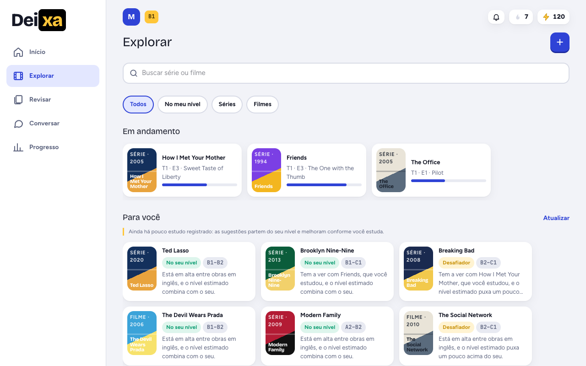
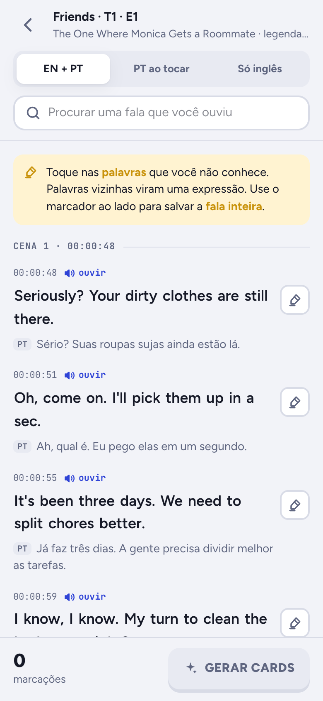
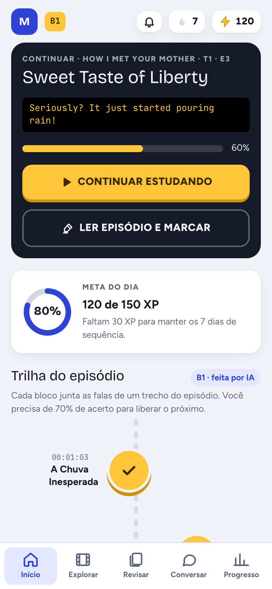
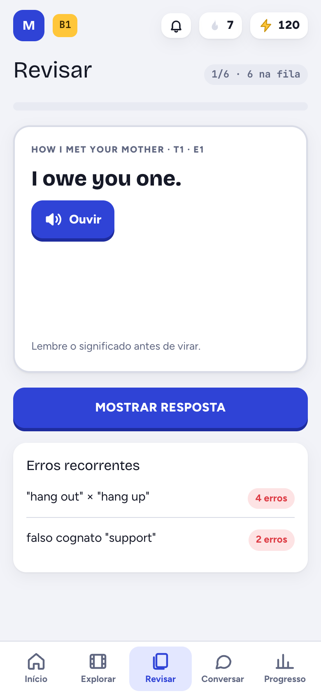

<div align="center">


# Deixa

**Aprenda inglês com as séries e os filmes que você já assiste.**

Leia o episódio inteiro, marque o que não entendeu e transforme as marcações em revisão.

[](https://github.com/matheus-caldeira/deixa/actions/workflows/ci.yml)
[](https://github.com/matheus-caldeira/deixa/releases)
[](LICENSE.md)
[](#instalar)


[Motivação](#motivação) · [O que ele faz](#o-que-ele-faz) · [Benefícios](#benefícios) · [Instalar](#instalar) · [Como usar](#como-usar) · [Direitos autorais](#direitos-autorais-e-pirataria) · [Licença](#licença)

</div>

---

<p align="center">
  
</p>

<p align="center">
  
  &nbsp;
  
  &nbsp;
  
</p>

<p align="center"><sub>As telas acima usam o seed de demonstração: os diálogos são fictícios, escritos para o projeto.</sub></p>

## Motivação

Quem estuda inglês costuma juntar duas ferramentas que não conversam entre si: um aplicativo de lições, com
frases que não têm nada a ver com a vida da pessoa, e um aplicativo de cartões, que exige montar tudo à mão.

Enquanto isso, a mesma pessoa passa horas vendo séries em inglês, com legenda em português, sem aproveitar
nada daquilo como estudo.

O Deixa nasceu para ligar as duas pontas. O material de estudo é o episódio que você acabou de ver ou vai ver:
as falas viram leitura, o que você não entendeu vira card, e o próprio episódio vira uma trilha de exercícios
no seu nível. Você estuda o inglês que realmente vai ouvir, com o contexto da cena na cabeça.

## O que ele faz

| Área          | O que você faz                                                                                             |
| ------------- | ---------------------------------------------------------------------------------------------------------- |
| **Explorar**  | Monta o catálogo de séries e filmes, por temporada e episódio, e recebe sugestões pelo seu gosto e nível   |
| **Ler**       | Lê o episódio inteiro com inglês e português alinhados por tempo, ouve cada fala e marca palavras e frases |
| **Cards**     | Transforma as marcações em cards com significado, pronúncia e exemplo, só para você ou para a casa toda    |
| **Estudar**   | Segue uma trilha de exercícios montada com as falas do episódio, dosada pelo seu nível                     |
| **Revisar**   | Revê os cards no momento certo, com repetição espaçada; tudo o que você erra volta para a revisão          |
| **Conversar** | Conversa com um tutor por texto ou áudio, com correção a cada mensagem                                     |
| **Progresso** | Acompanha sequência de dias, XP, missões e quem mais está estudando na mesma instalação                    |

O catálogo é compartilhado entre as contas da mesma instalação; o aprendizado é individual.

## Benefícios

- **Conteúdo que é seu.** Você estuda o que escolheu assistir, não frases genéricas.
- **Contexto real.** Cada palavra vem com a fala, a cena e a tradução da própria legenda.
- **Tudo num lugar só.** Leitura, cards, exercícios, revisão e conversa, sem exportar nada de um app para outro.
- **Seus dados ficam com você.** Roda no seu computador, com banco de dados seu. Nada vai para um servidor nosso.
- **Funciona sem IA.** Ler, marcar e revisar não dependem de chave nenhuma. Com chave, a IA explica os termos,
  monta as trilhas, sugere obras e conversa com você.
- **Suas chaves, sua cota.** Cada pessoa cadastra as próprias chaves de TMDB, OpenSubtitles e Gemini.
- **Para a casa toda.** Várias contas na mesma instalação, cada uma com seu nível e seu progresso.
- **No computador e no celular.** Aplicativo para macOS, Windows e Linux, e acesso pelo celular na mesma rede
  por QR code.

## Instalar

Baixe o instalador do seu sistema na [página de releases](https://github.com/matheus-caldeira/deixa/releases).
Os instaladores **não são assinados** com certificado pago, então cada sistema pede uma liberação na primeira
vez. Cada release traz arquivos `SHA256SUMS-*.txt` para conferir o download.

| Sistema     | Arquivo               | Primeira abertura                                                    |
| ----------- | --------------------- | -------------------------------------------------------------------- |
| **macOS**   | `.dmg`                | Ajustes do Sistema → Privacidade e Segurança → "Abrir Mesmo Assim"   |
| **Windows** | `.msi` ou `.exe`      | No aviso do SmartScreen, "Mais informações" → "Executar assim mesmo" |
| **Linux**   | `.deb` ou `.AppImage` | Para o AppImage, dê permissão de execução                            |

O Deixa precisa de um **PostgreSQL**. Na primeira abertura ele procura um no computador e pede os dados de
conexão; se não houver nenhum, mostra o que instalar.

> Versão 0.0.1. O projeto está no começo: espere arestas, e conte o que encontrar.

## Como usar

1. **Abra o Deixa.** Ele fica na bandeja do sistema e abre numa janela própria.
2. **Configure o banco.** Escolha o PostgreSQL encontrado ou informe o endereço. As tabelas são criadas sozinhas.
3. **Crie a sua conta.** A primeira conta é a administradora da instalação.
4. **Cadastre as chaves, se quiser.** No perfil, em "Suas chaves de API". Sem elas o app funciona em modo de
   demonstração e com envio manual de legenda.
5. **Adicione uma obra.** Em Explorar, toque em "+", busque a série ou o filme e escolha o episódio.
6. **Traga a legenda.** Envie os seus arquivos `.srt` em inglês e em português, ou busque no OpenSubtitles com
   a sua chave. Nada é baixado sem você confirmar.
7. **Leia e marque.** Toque nas palavras que não conhece; palavras vizinhas viram uma expressão.
8. **Gere os cards e estude.** Os cards entram na revisão, e a trilha do episódio fica disponível no Início.

### Chaves de API

| Serviço           | Para quê                                                 | Sem a chave                               |
| ----------------- | -------------------------------------------------------- | ----------------------------------------- |
| **TMDB**          | Buscar séries, filmes, temporadas e imagens              | Só as obras de demonstração               |
| **OpenSubtitles** | Buscar e baixar legendas quando você pede                | Envio manual dos arquivos `.srt`          |
| **Google Gemini** | Explicar termos, montar trilhas, sugerir obras e o tutor | Explicações simuladas; a revisão funciona |

As chaves ficam criptografadas no seu banco e nunca voltam para o navegador.

### No celular

No menu da bandeja, "Abrir no celular (QR code)" mostra o endereço do Deixa na sua rede. O celular precisa
estar na mesma rede do computador.

### A partir do código

Para rodar em modo de desenvolvimento, testar ou empacotar, veja [docs/DEVELOPMENT.md](docs/DEVELOPMENT.md).

```bash
pnpm install && pnpm setup:env && docker compose up -d && pnpm db:seed && pnpm dev
```

## Direitos autorais e pirataria

**O Deixa não distribui, não hospeda e não dá acesso a séries, filmes nem legendas.**

- O aplicativo **não reproduz vídeo**. Ele trabalha só com texto de legenda.
- O repositório e os instaladores **não trazem nenhuma legenda real**. Os exemplos são diálogos fictícios,
  escritos para o projeto.
- As legendas que você usa são **suas**: você envia os arquivos ou as busca no OpenSubtitles com a sua própria
  chave, por decisão sua, um episódio de cada vez.
- O TMDB é usado apenas para identificar as obras (títulos, temporadas e imagens).
- Tudo o que você importa fica no seu computador. O projeto não mantém catálogo nem servidor de conteúdo.

Você é responsável por ter o direito de usar o conteúdo que importar. Não use o Deixa para compartilhar
material protegido, e não abra pedidos de ajuda para obter séries, filmes ou legendas.

## Como é feito

Monólito modular em TypeScript: Next.js e React na interface e no servidor, PostgreSQL com Drizzle, e uma casca
em Tauri que empacota tudo num aplicativo de bandeja. Cada serviço externo fica atrás de uma interface, com uma
implementação de reserva usada nos testes e quando falta credencial.

Detalhes em [docs/DEVELOPMENT.md](docs/DEVELOPMENT.md), decisões em [docs/DECISIONS.md](docs/DECISIONS.md) e
pendências em [docs/HANDOFF.md](docs/HANDOFF.md).

## Próximos passos

- Versão que roda inteira no navegador, sem servidor: [rascunho](docs/WEB-OFFLINE-DRAFT.md).
- Importar e exportar episódios, cards e dados pessoais: [rascunho](docs/OFFLINE-EXPORT-DRAFT.md).
- Escolha do provedor de IA e controle de custo.

## Licença

O Deixa tem o código aberto para **uso não comercial**. Em resumo:

- **Qualquer pessoa pode usar, estudar, copiar e modificar**, sem pagar nada.
- **Quem modificar precisa publicar as alterações**, com o código-fonte, sob a mesma licença.
- **O uso comercial é reservado ao autor.** Vender, cobrar pelo acesso ou incluir o Deixa em produto pago
  depende de autorização por escrito.

Por restringir o uso comercial, esta não é uma licença "open source" no sentido estrito do termo. O texto
completo, que é o que vale, está em [LICENSE.md](LICENSE.md).

## Créditos

- Metadados de séries e filmes: [TMDB](https://www.themoviedb.org). This product uses the TMDB API but is not
  endorsed or certified by TMDB.
- Busca de legendas a pedido do usuário: [OpenSubtitles](https://www.opensubtitles.com).
- Fontes Bricolage Grotesque, Figtree e JetBrains Mono, sob a licença OFL.

## Autor

**Matheus Caldeira**

[matheuscardozo4@gmail.com](mailto:matheuscardozo4@gmail.com) · +55 41 99524-5271
